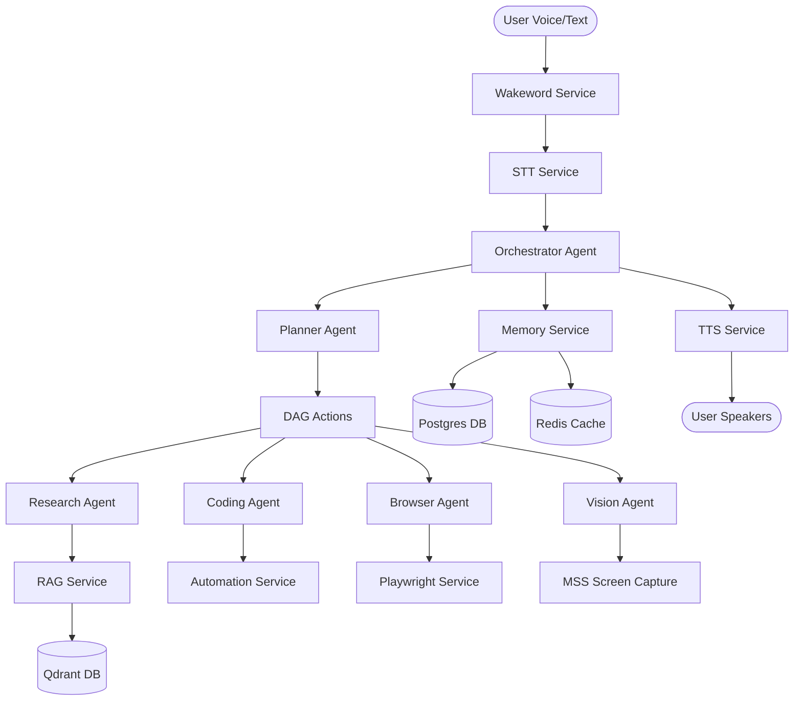

# A.T.L.A.S Context & Workspace Index

Autonomous Thinking Learning Assistance System (A.T.L.A.S) is a Personal Cognitive Operating System designed to orchestrate voice, memory, browser, coding, and vision agents.

---

## 1. Directory Structure & File Index

The codebase is organized into modular directories representing agents, services, databases, integrations, infrastructure, and apps.

### Core Agents (`/agents/`)
- [orchestrator-agent/orchestrator.py](file:///c:/Projects/A.T.L.A.S/agents/orchestrator-agent/orchestrator.py): LangGraph Orchestrator configuration. Defines the master state graph. Currently mocked.
- [planner-agent/planner.py](file:///c:/Projects/A.T.L.A.S/agents/planner-agent/planner.py): Decomposes user goals into DAG plan sequences. Currently mocked.
- [research-agent/researcher.py](file:///c:/Projects/A.T.L.A.S/agents/research-agent/researcher.py): Coordinates RAG service and Web browser scraping to synthesize topic summaries.
- [browser-agent/browser.py](file:///c:/Projects/A.T.L.A.S/agents/browser-agent/browser.py): Controls Playwright browser automation for web tasks.
- [coding-agent/coder.py](file:///c:/Projects/A.T.L.A.S/agents/coding-agent/coder.py): Generates code blocks and debugs compiler errors.
- [vision-agent/vision.py](file:///c:/Projects/A.T.L.A.S/agents/vision-agent/vision.py): Coordinates screenshot capturing and layout/OCR processing.
- Other agents (`accessibility.py`, `email.py`, `memory.py`, `teams.py`) are stubs.

### Core Services (`/services/`)
- [stt.py](file:///c:/Projects/A.T.L.A.S/services/stt.py): Speech-to-Text using Faster-Whisper. Falls back to mock transcription if missing package.
- [tts.py](file:///c:/Projects/A.T.L.A.S/services/tts.py): Text-to-Speech using ElevenLabs cloud or Coqui/XTTS local synthesis.
- [wakeword.py](file:///c:/Projects/A.T.L.A.S/services/wakeword.py): Listening loop for "Hey Atlas" wake phrase via Porcupine.
- [memory.py](file:///c:/Projects/A.T.L.A.S/services/memory.py): Stores session histories in Postgres and caches recent context in Redis.
- [rag.py](file:///c:/Projects/A.T.L.A.S/services/rag.py): Ingests texts and queries vector search in Qdrant database.
- [browser.py](file:///c:/Projects/A.T.L.A.S/services/browser.py): Scrapes web pages using Playwright.
- [vision.py](file:///c:/Projects/A.T.L.A.S/services/vision.py): Takes screenshots via `mss` and performs local OCR.
- [automation.py](file:///c:/Projects/A.T.L.A.S/services/automation.py): Runs local shell commands and launches desktop applications.

### Databases (`/databases/`)
- [postgres/connection.py](file:///c:/Projects/A.T.L.A.S/databases/postgres/connection.py): RealDictCursor execution for PostgreSQL.
- [redis/connection.py](file:///c:/Projects/A.T.L.A.S/databases/redis/connection.py): Key-value storage and cache retrieval helper.
- [qdrant/connection.py](file:///c:/Projects/A.T.L.A.S/databases/qdrant/connection.py): Vector search and indexing interfaces.
- [neo4j/connection.py](file:///c:/Projects/A.T.L.A.S/databases/neo4j/connection.py): Graph relationship database connector.

### Client Applications (`/apps/`)
- [desktop-client/package.json](file:///c:/Projects/A.T.L.A.S/apps/desktop-client/package.json): Next.js app config. Desktop Client front-end dashboard.
- [mobile-client/pubspec.yaml](file:///c:/Projects/A.T.L.A.S/apps/mobile-client/pubspec.yaml): Flutter config.

### Infrastructure (`/infrastructure/` & `/observability/`)
- [docker/docker-compose.yml](file:///c:/Projects/A.T.L.A.S/infrastructure/docker/docker-compose.yml): Configures Postgres (5432), Redis (6379), Qdrant (6333), and Neo4j (7474/7687).
- [prometheus.py](file:///c:/Projects/A.T.L.A.S/observability/prometheus.py): Exposes metric collections for latency tracking.

---

## 2. Architecture & Control Flow

