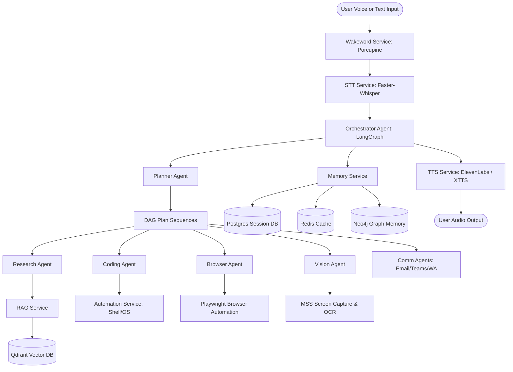

# A.T.L.A.S — System Manual & Feature Catalog

This document provides a detailed overview of the **Autonomous Thinking Learning Assistance System (A.T.L.A.S)**. It outlines the core architecture, individual agents, backend services, database connectors, client dashboards, and deployment setups.

---

## 1. System Vision & High-Level Architecture

A.T.L.A.S is designed as a **Personal Cognitive Operating System** (AI-OS) operating on desktop and mobile clients. Instead of acting as a simple stateless chat helper, A.T.L.A.S runs a continuous orchestration loop using voice-activation, multi-agent graphs, multi-layered databases, and screen/desktop automation.



---

## 2. Multi-Agent Orchestration Stack (`/agents/`)

A.T.L.A.S utilizes a multi-agent routing graph compiled under **LangGraph**. The Orchestrator routes user queries to specialized sub-agents based on the generated task steps.

### 2.1 Orchestrator Agent (`orchestrator.py`)
- **Role**: Coordinates the entire lifecycle of a request.
- **Features**:
  - Intercepts incoming messages or transcriptions.
  - Maintains state variables throughout execution.
  - Dispatches plans to the *Planner Agent*.
  - Publishes live telemetry and step-by-step thinking logs to client WebSocket connections.

### 2.2 Intent Planner Agent (`planner.py`)
- **Role**: Decomposes user goals into a Directed Acyclic Graph (DAG) of task steps.
- **Features**:
  - Generates JSON-based DAG sequences dynamically.
  - Resolves dependencies between steps (e.g., must scrape a page before summarizing it).
  - Handles execution status feedback loops.

### 2.3 Research Agent (`researcher.py`)
- **Role**: Gathers and synthesizes contextual reference documents.
- **Features**:
  - Automatically queries the local knowledge base using RAG.
  - Scrapes search engine result pages (DuckDuckGo/Bing) using Playwright.
  - Consolidates scattered reference points into single-page Markdown summaries.

### 2.4 Coding Agent (`coder.py`)
- **Role**: Automates file modifications and script execution.
- **Features**:
  - Generates full source code files or targeted line diffs.
  - Runs safe linter/compiler checks (e.g., Python linters, ESLint).
  - Evaluates standard error outputs to self-heal code compilation issues.

### 2.5 Browser Agent (`browser.py`)
- **Role**: Operates browser sessions for interactive website tasks.
- **Features**:
  - Automates clicking, text typing, form submission, and login flows.
  - Supports headless running for background operations and headful running for user inspection.

### 2.6 Vision Agent (`vision.py`)
- **Role**: Visual context gatherer.
- **Features**:
  - Requests monitor screenshot grabs.
  - Processes image layout structure.
  - Utilizes local OCR engines (Tesseract) or Vision LLMs (Gemini-V) to parse visible error messages or layout issues.

### 2.7 Memory, Accessibility & Communication Agents
- **Memory Agent**: Classifies long-term preferences, active projects, and user habits.
- **Accessibility Agent**: Simulates mouse clicks/keystrokes for disabled users.
- **Email/Teams/WhatsApp Agents**: Synthesizes and drafts correspondence across corporate and chat tools.

---

## 3. Core Backend Services (`/services/`)

The backend services act as the concrete utility layers implementing voice synthesis, speech transcription, page scraping, and operating system controls.

| Service | Technology | Details / Implementation |
| :--- | :--- | :--- |
| **STT** (`stt.py`) | Faster-Whisper | Converts microphone input audio files (`.wav`/`.mp3`) into plain text using CPU-optimized transcription models. Falls back to mock transcription when packages are absent. |
| **TTS** (`tts.py`) | ElevenLabs & Coqui XTTS | Generates human-like voice responses. Uses cloud-based ElevenLabs API keys by default, falling back to local XTTS/Coqui voice clones for offline air-gapped setups. |
| **Wakeword** (`wakeword.py`) | Porcupine Wake Word | Keeps an active micro-listener thread open for the trigger phrase *"Hey Atlas"*, transitioning the system state to processing mode upon detection. |
| **Browser** (`browser.py`) | Playwright | Launches browser page scrapers and processes DOM contents. |
| **Vision** (`vision.py`) | `mss` & OpenCV / PIL | Captures screenshots of multi-monitor arrays, crops target areas, and prepares them for OCR extraction. |
| **Automation** (`automation.py`) | Python subprocess | Executes local commands in isolated shell runtimes to build, lint, and deploy code. |
| **RAG** (`rag.py`) | Qdrant + Embeddings | Chunks files/emails, generates vector embeddings (1536-dim), and indices them in local vector spaces for rapid retrieval. |

---

## 4. Multi-Layer Database Stack (`/databases/`)

A.T.L.A.S integrates four database types configured via docker-compose, enabling persistent graph reasoning, vector search, caching, and traditional relational logs.

```
                  ┌─────────────────────────────────────┐
                  │        A.T.L.A.S Data Flow          │
                  └──────────────────┬──────────────────┘
                                     │
         ┌───────────────────┬───────┴───────────┬───────────────────┐
         ▼                   ▼                   ▼                   ▼
  ┌─────────────┐     ┌─────────────┐     ┌─────────────┐     ┌─────────────┐
  │ PostgreSQL  │     │    Redis    │     │   Qdrant    │     │    Neo4j    │
  ├─────────────┤     ├─────────────┤     ├─────────────┤     ├─────────────┤
  │ Session logs│     │ Fast caching│     │ Vector RAG  │     │ Graph Rel   │
  │ History     │     │ Wake state  │     │ Knowledge   │     │ Preferences │
  └─────────────┘     └─────────────┘     └─────────────┘     └─────────────┘
```

1. **PostgreSQL** (`/databases/postgres/`)
   - **Version**: 15-alpine
   - **Port**: 5432
   - **Schema**: Stores system interaction histories, user profile settings, and persistent task execution records using `RealDictCursor`.
2. **Redis** (`/databases/redis/`)
   - **Version**: 7-alpine
   - **Port**: 6379
   - **Schema**: Caches live state variables, active telemetry parameters, and wake status indicators to minimize PostgreSQL read load.
3. **Qdrant** (`/databases/qdrant/`)
   - **Version**: latest
   - **Port**: 6333 / 6334
   - **Schema**: Holds multi-collection vector indices for general documentation, code files, and email indexes.
4. **Neo4j** (`/databases/neo4j/`)
   - **Version**: 5-community
   - **Port**: 7474 (HTTP) / 7687 (Bolt)
   - **Schema**: Maps relationships between concepts, technologies, user projects, and communication channels.

---

## 5. Client Applications (`/apps/`)

### 5.1 Desktop Control Deck (`desktop-client/`)
Built with **Next.js**, **React**, and **Lucide Icons** to serve as a visual telemetry command center.
- **Cyber Telemetry Dashboard**: Displays real-time database connection statuses (PostgreSQL, Redis, Qdrant, Neo4j), roundtrip latency (ms), and backend load percentages.
- **Hologram Voice Receptor**: Features a pulsing visual ring representing the voice-control state (Listening, Processing, Sleeping). Users can click to toggle the wake status.
- **Orchestrator Thought Stream Terminal**: Shows color-coded system event sequences, databases calls, agent steps, and user commands over a WebSocket connection (`/ws`).
- **Interactive Inspector**: Inspects target agent statistics, specific nodes schemas, and functional capabilities.
- **Web Speech Recognition integration**: Embeds browser-level webkit Speech Recognition to capture voice commands and parse the "Hey Atlas" wake phrase on the client side.

### 5.2 Mobile Client (`mobile-client/`)
A cross-platform Flutter application providing remote voice inputs and status notifications on mobile devices.

---

## 6. How to Configure & Start the System

### 6.1 Prerequisites
Ensure you have Docker, Python 3.10+, and Node.js 18+ installed on your system.

### 6.2 Spin up Database Infrastructure
From the workspace root directory:
```bash
docker-compose -f infrastructure/docker/docker-compose.yml up -d
```
Verify databases are running on ports `5432` (Postgres), `6379` (Redis), `6333` (Qdrant), and `7474` (Neo4j).

### 6.3 Configuration (.env)
Create a root level environment file:
```env
# Database Settings
POSTGRES_HOST=localhost
POSTGRES_PORT=5432
POSTGRES_USER=atlas_admin
POSTGRES_PASSWORD=atlas_password_9921
POSTGRES_DB=atlas_db

REDIS_HOST=localhost
REDIS_PORT=6379

NEO4J_URI=bolt://localhost:7687
NEO4J_USER=neo4j
NEO4J_PASSWORD=atlas_neo4j_password_9921

QDRANT_HOST=localhost
QDRANT_PORT=6333

# AI & Voice Keys
OPENAI_API_KEY=your_key_here
ELEVENLABS_API_KEY=your_elevenlabs_key
PORCUPINE_ACCESS_KEY=your_porcupine_key
```

### 6.4 Start Backend Server
Install required packages and run the FastAPI server:
```bash
pip install fastapi uvicorn websockets psycopg2-binary redis qdrant-client neo4j faster-whisper mss opencv-python pillow playwright
playwright install
python server.py
```

### 6.5 Start Desktop Client
Run the Next.js frontend:
```bash
cd apps/desktop-client
npm install
npm run dev
```
Open [http://localhost:3000](http://localhost:3000) to access the control deck.
